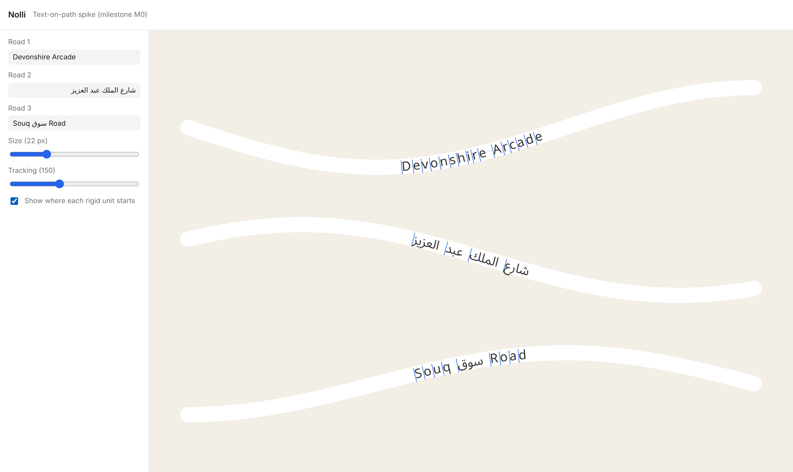

# Rebuilding Nolli as a web app with desktop wrappers

Goal: a Figma-style editor in the browser with the features of the macOS app, wrapped for Mac, Windows and Linux, aimed at graphic and wayfinding designers working on urban areas and small public spaces. Features beyond parity with the macOS app, and Illustrator integration, are in [ROADMAP.md](ROADMAP.md).

**Status:** milestone M0 is done (see "Milestones"). Everything after it is a plan.

## Goals

1. Open every `.nolli` file the macOS app saved, and save files it can open back (`PROJECT_FORMAT.md`).
2. Same output: the same labels in the same places, the same SVG, PDF and Illustrator script.
3. The redesigned interface in `design/redesign/`.
4. One codebase that runs in a browser and inside a desktop wrapper.
5. Road names in any script, including right-to-left and joined scripts.

Not in version 1: accounts, cloud storage, real-time collaboration. The document model uses immutable snapshots so they can be added later.

## Decisions made

| Question | Decision |
|---|---|
| UI framework | React |
| Desktop wrapper | Electron. It ships one browser engine everywhere, so canvas speed and font access are the same on every system. Now that text is shaped from font bytes, the app no longer depends on the engine for text, so Tauri could replace it later if download size matters |
| Text | Shaped from font bytes with HarfBuzz; see "Text" |
| Tiles | OpenStreetMap for now, behind an interface that allows other providers and formats; see "Tiles" |
| Storage | Local-first: files on disk, no server |
| Edit mode | No Save / Revert All. Edits apply at once and rely on undo, with reset per item and per layer |
| Roads in the layer list | One row, with road types as chips in the inspector |

Still open: a licence for the repository, and code signing (Apple Developer account, Windows certificate) before installers are distributed.

## Structure

`web/` is an npm workspace:

| Package | Holds | Rule |
|---|---|---|
| `packages/core` | Model, project load and save, projection, camera, geometry, text, label layout, scene, exporters | No DOM and no Node APIs (enforced by its TypeScript config and a lint rule), so it runs in the page, a worker, tests and a command line |
| `apps/editor` | React UI and the canvas | |
| `apps/desktop` | Electron shell | Thin: file open and save, `.nolli` association, font access |

Other choices: TypeScript in strict mode, Vite, Vitest, plain Canvas 2D drawn in a worker (`OffscreenCanvas`) with the finished bitmap moved by CSS transforms during gestures. WebGL can come later if measurement says it is needed.

### Text

The macOS app measured text with CoreText. The web app shapes text itself, from the font file, with HarfBuzz compiled to WebAssembly (`harfbuzzjs`):

- Label placement is then identical in every browser, in the desktop app and in tests.
- The same glyph outlines feed the canvas, SVG export and PDF export.
- Any script HarfBuzz supports works, given a font that covers it.

How it works (`packages/core/src/text`):

1. A line is split into runs by direction (Unicode bidirectional algorithm, `bidi-js`) and by font. Each character uses the first font in the project's **fallback chain** that has a glyph for it.
2. Each run is shaped and the runs are put in visual order.
3. Glyphs are grouped into **units**, the pieces that move rigidly along a path. A unit is one cluster (a letter with its marks, or a ligature). In joined scripts such as Arabic a unit is a whole word, because rotating letters separately would break the joins. Tracking is added between units, so it never pulls a joined word apart.
4. `placeOnPath` sets each unit tangent to the path at the unit's middle and reports the sharpest bend between neighbours, which is what the "max bend" rule needs.

The blue ticks mark where each rigid unit starts: one per letter in Latin, one per word in Arabic.

Limits known today:
- A long joined word on a tight curve stays straight and can leave the road. The label engine will have to treat such a word like a bend that is too sharp.
- Only Latin and Arabic have been looked at. Indic and East Asian scripts should work but are untested.
- Projects name fonts that are licensed to the user (for example "Onsite Standard TRIAL"). The app needs the font's bytes: from the system through the desktop shell or the browser's local-font permission, or uploaded. A project that names a missing font opens a dialog to map it to another. Font files are never committed.

### Tiles

Tiles are a tracing aid and are never exported. `packages/core/src/tiles/TileSource.ts` describes a source: URL template, attribution, zoom range and an optional API key, which stays in app settings and out of project files. OpenStreetMap's server is the only built-in source; its policy rules out a public app with real traffic, so a keyed provider is needed before then. The `kind` field is where vector tiles, PMTiles and a georeferenced reference image will be added.

### Files

- Chrome, Edge and the desktop app open and save in place.
- Safari and Firefox fall back to upload and download.
- Autosave, recent files and local version history live in the browser's storage (IndexedDB).

## Interface

The spec is `design/redesign/REDESIGN-BRIEF.md` with its three screens. Read `design/redesign/README.md` first for what the screens do not show. In short:

- Four phases as tabs, free to jump between: **Area · Style · Signs · Export**.
- A flat layer list with a **Map** row first; Roads once, with type chips and `Line | Labels` tabs.
- Collapsible inspector sections; a visible dot on overridden fields and a "N values differ" bar with Reset all.
- An amber banner when names do not fit. Beyond the brief: click a road to see why its name was dropped.
- Export as a view that owns the artboard tool, not a sheet.

Differences from the brief:
- Inter and Lucide in place of SF Pro and SF Symbols.
- Edit mode shows **Reset edits** in place of Save / Revert All.

The brief left five questions open. These defaults stand until changed: phase tabs in the toolbar centre; signs are placed with `+` then a click; dark mode uses its own tokens (the current ones in `web/apps/editor/src/tokens.css` are provisional); Map settings are a row in the layer list; the phase bar stays.

## Module map: Swift to TypeScript

Paths are in `macos/Nolli/`. Line counts are from the current source and show where the effort is.

| Swift | Lines | Becomes | Notes |
|---|---|---|---|
| `Models/MapLayer`, `Styles`, `OSMFeature`, `SignOutput`, `BoundingBox` | ~1,050 | `core/model` | Types plus a runtime validator (zod). Defaults live here |
| `Services/ProjectManager` | 227 | `core/project` | Load with default-filling (`upgraded`) and the version 7 migration; save |
| `Models/MapCamera`, `Views/MapProjection` | ~300 | `core/camera`, `core/projection` | Pure Web Mercator maths. Easy and a good first port |
| `Models/PolygonCenter` | 95 | `geo/polygonCenter` | Pure functions; watch the `[lat, lon]` return order |
| `Services/OSMFetcher` | 205 | `data/overpass` | Includes multipolygon assembly. The default server answers browser requests (tested: HTTP 200 with `access-control-allow-origin: *`; the other public server was busy but sent the same header) |
| `Services/GeocoderService` | 45 | `data/geocode` | Nominatim; browser requests allowed (tested). Its usage policy still applies |
| `Services/TileStore` | 156 | `render/tiles` | Fetch plus cache (memory and IndexedDB). Fall back to the parent tile while loading |
| **`Views/LabelRendering`** | **878** | **`layout/labels`** | **The hardest part.** Text on a path with bend, repeat and overlap rules, stitching of ways, pins |
| `Views/SceneRenderer` | 701 | `render/scene` | Compile the document into drawable chunks, then draw |
| `Views/MapSurfaceView` | 1,111 | `canvas/MapCanvas` | Gestures, edit handles, overlay. Move the finished bitmap with CSS transforms during gestures |
| `Services/SVGExporter` (includes the Illustrator script) | 823 | `export/svg`, `export/jsx` | Mostly string building; straightforward once layout exists |
| `Services/PDFExporter`, `SignExporter` | 214 | `export/pdf`, `export/sign` | PDF needs fonts embedded; see risks |
| `Models/AppState`, `Services/DocumentActions` | ~630 | `core/store`, `core/actions` | One edit path that redraws, marks dirty and records undo |
| `Views/*` panels and inspectors | ~3,600 | `ui/*` | Rebuild from `design/` (`tokens.css` is ready to use) |

Roughly 10,000 lines of Swift in total. The UI is about 36 percent of it; the part that decides whether the result is right is the layout engine and exporters.

Roughly 10,000 lines of Swift in total. The UI is about 36 percent of it and is being redesigned, not ported; the part that decides whether the result is right is the layout engine and the exporters.

## What to carry over unchanged

These design decisions came out of real use and cost real effort to get right. Keep them:

1. **One camera** (centre, zoom, rotation) drives everything.
2. **Artwork space** is Web Mercator pixels at the project's base zoom, relative to a scene origin. Line widths, text and icons scale with it like vector artwork. Labels never depend on the current zoom.
3. **Rotation is heading-up**: `x' = x cos r + y sin r`. Labels and icons stay upright; curved labels keep a forward and a reversed run and pick the one that reads upright.
4. **Layout is computed once and cached** by a hash of the values that affect placement (colour changes don't invalidate it).
5. **Priority order**: icons claim space first, then hand-placed pins, then automatic labels in layer order, top row first.
6. **Inheritance per field**: road types inherit from their master; `lineOverrides` and `labelOverrides` list what a type has changed.
7. **Defaults on load**: fill missing keys before validating.
8. **Exports use the same layout as the screen**, so they match.

## Risks

1. **Label parity.** HarfBuzz and CoreText agree closely on advances but not exactly, so labels will not match the macOS app to the pixel. Decide the tolerance when the first fixtures exist (suggest 1 to 2 px at design scale).
2. **PDF.** Needs real vector text with embedded fonts. Check that the chosen library can embed the same fonts, and test with a non-Latin name.
3. **Illustrator script.** It has only been checked to compile, never run in Illustrator. Test it there before building on it.
4. **Performance.** Measure early on a large file (about 1,200 roads and 1,900 buildings).
5. **Gestures.** Trackpad pinch, pan and twist differ between browsers, and the macOS app's own gestures were never tested with a trackpad.
6. **Public services.** Overpass and Nominatim answer browser requests (tested for the original plan), but their usage policies still apply.

## Proving parity

The macOS app is the reference.

1. Add a layout dump to the macOS app: each placed label's text, position and angle as JSON. This is a small Swift change that has to be built and run on a Mac.
2. Dump each real project at fixed settings and keep the results as fixtures (not committed if they hold client data).
3. In the web app, compare: same labels placed, same text and rotation, position within the tolerance.
4. Repeat for several rotations and zoom levels, because placement must not change with them.

## Milestones

Each one ends with something that can be opened and checked.

| # | Milestone | Done when |
|---|---|---|
| M0 | Scaffolding, CI, text spike | **Done.** Lint, tests and build pass; Latin, Arabic and mixed names are shaped from font bytes and set on a curve |
| M1 | Model and loader | Real `.nolli` files load and round-trip |
| M2 | Desktop shell (thin) | Electron opens and saves a `.nolli` file |
| M3 | Camera, vector rendering, tiles, gestures | A project draws at any zoom and rotation over tiles with no drift |
| M4 | Label engine | Placement matches the macOS fixtures within tolerance |
| M5 | Style phase | Layers, inspectors, chips, overrides, colour panel, undo |
| M6 | Area phase and data | Search, draw area, Overpass fetch, refresh that keeps manual edits |
| M7 | Edit mode | Slide, pin, vertex edit, reset; reasons for dropped labels |
| M8 | Signs phase | List, preview, placement, batch export |
| M9 | Export phase | SVG, PDF, Illustrator script |
| M10 | Installers, dark mode, accessibility | Signed builds from CI; text contrast meets WCAG AA |
| M11+ | Roadmap features | See [ROADMAP.md](ROADMAP.md) |

M1 needs test copies of real `.nolli` files; none are in the repository.
